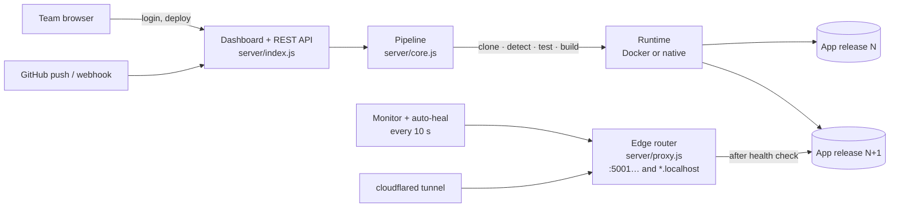

# ShipStack

A DevOps deployment service for small web projects. A team signs up, pastes a GitHub repo (or uploads a ZIP, or picks a template), and ShipStack:

1. **Fetches the source**: `git clone` (private repos via token), ZIP extract, or template copy
2. **Detects the stack and scans it**: Node/Express, Next.js, React/Vue/Angular (Vite/CRA), Flask, FastAPI, Django, Streamlit, Go, static HTML, or the repo's own Dockerfile, plus a scan for committed secrets
3. **Runs the automated tests**: `npm test`, `pytest` or `go test`; failing tests block the release
4. **Builds and containerizes**: generates a Dockerfile and builds an image (or prepares a native release)
5. **Deploys**: starts the new release beside the old one, with plan limits on memory and CPU
6. **Health-checks it**: HTTP probe up to 120 s
7. **Goes live with zero downtime**: traffic switches only after the health check passes, then the old release is retired

After that it keeps the app **monitored** (uptime every 10 s, response time, CPU/memory, requests/min), **auto-heals** it (restarts after 3 failed checks), **redeploys on every git push** (polling plus webhook), and keeps the last 5 releases for **one-click rollback**.

## Run it

Needs **Node 18+** and **Git**. **Docker Desktop** is recommended. Without Docker, apps run as normal processes on the machine, which also needs Python 3 for Python apps.

```bash
npm install      # no dependencies; nothing to download
npm start        # → http://localhost:8080
```

Open the dashboard, **create an account**, and deploy a template or a repo such as `https://github.com/render-examples/flask-hello-world`.

If port 8080 is taken: `PORT=8090 npm start` (PowerShell: `$env:PORT=8090; npm start`).

Stop it with **Ctrl+C**, which also stops the native app processes. Docker containers keep running and are adopted again on the next start.

## Where each app is reachable

| Link | Example |
|---|---|
| Stable port per project | `http://localhost:5008` |
| Subdomain | `http://portfolio.localhost:8080` |
| LAN / phone (same Wi-Fi) | `http://192.168.x.x:5008` |
| Public internet | `https://xyz.trycloudflare.com` (needs `cloudflared`, or OpenSSH for localhost.run) |

## Configuration (environment variables)

| Variable | Default | Meaning |
|---|---|---|
| `PORT` | `8080` | Dashboard / API port |
| `HOST` | `0.0.0.0` | Interface to listen on |
| `SHIPSTACK_DATA` | `~/.shipstack` (Windows), `./data` (others) | Database, releases, logs, uploads |
| `SHIPSTACK_RUNTIME` | auto | `native` forces processes even if Docker is present |
| `SHIPSTACK_PUBLIC_URL` | request host | Public base URL, used in webhook links when hosted on a server |
| `ALLOW_SIGNUP` | `true` | `false` closes registration |
| `MAX_PROJECTS_PER_USER` | `10` | Project quota per account |
| `MAX_CONCURRENT_BUILDS` | `2` | Build queue size |
| `APP_PORT_START` | `5001` | First port handed to projects |

## Architecture



| File | Role |
|---|---|
| `server/index.js` | HTTP server, accounts and sessions, REST API, live streams (SSE), webhooks, ZIP upload, subdomain routing |
| `server/core.js` | Projects, deployments, the 7-stage pipeline, monitoring, auto-heal, git polling, rollback, release pruning |
| `server/detect.js` | Stack detection, generated Dockerfile / compose / GitHub Actions / nginx, secret scan |
| `server/runtime.js` | Docker runtime (build, run with `--memory/--cpus`, stats, logs) and native runtime (venv/npm, processes) |
| `server/proxy.js` | Per-project stable port, static file serving, HTTP and WebSocket proxying, request counting |
| `server/tunnel.js` | Public URLs through cloudflared or localhost.run |
| `public/` | The dashboard (single-page app) |
| `samples/` | The four one-click templates |

## Security

- Passwords hashed with scrypt; sessions are random 256-bit tokens (only the SHA-256 is stored), HttpOnly SameSite cookies
- CSRF protection: every state-changing request needs an `X-Requested-With` header
- Login rate limit (10 failures / 15 min per IP)
- Every project, deployment and log is scoped to its owner
- Git tokens and environment-variable values are masked in all logs
- Deploy hooks use a per-project random token, compared in constant time
- Repo URL, branch and root directory are validated; commands run without a shell where possible; ZIP size capped at 250 MB

## Hosting it for real

1. Get a Linux VM (e.g. AWS Lightsail / EC2, 2 GB+) and install Docker, Git and Node 20.
2. `git clone` this project, then `PORT=8080 SHIPSTACK_PUBLIC_URL=https://deploy.yourdomain.com npm start` (use `pm2` or a systemd service to keep it running).
3. Put Caddy or nginx in front for HTTPS, with a wildcard DNS record `*.yourdomain.com` if you want app subdomains.
4. In each GitHub repo: Settings → Webhooks → paste the project's hook URL (Project → Settings).

## Limits of this version

- **Native mode is not isolated.** Without Docker, apps run as normal processes with your user's permissions and no memory/CPU limits. Use Docker for anything multi-tenant.
- **JSON-file database** (`db.json`): fine for one server and a class project; swap for PostgreSQL to scale out.
- **Billing is not connected.** The plans (Starter / Standard / Pro) set resource limits, but no payment provider is integrated.
- Apps that need their own database or secrets must get them through environment variables (Settings).
